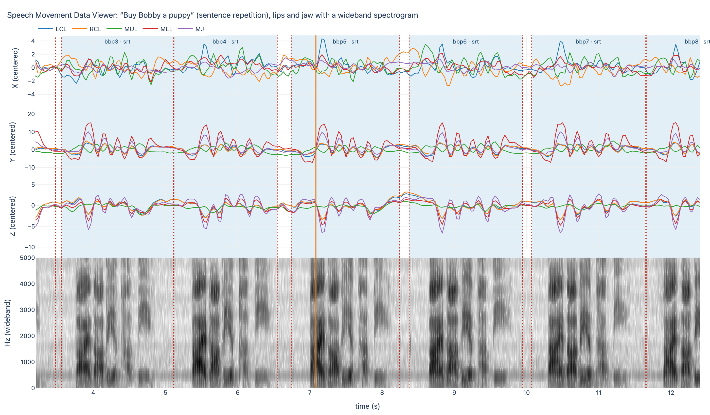

# How to use WCKDSMAT

This guide walks you from a webcam video to per-segment lip, jaw and head kinematics, one step at a time. Each step is a single command; every command takes `--help`.

**Contents**

1. [Install](#1-install)
2. [Try it with the demo recording](#2-try-it-with-the-demo-recording)
3. [Track the face](#3-track-the-face)
4. [Calibrate and preprocess](#4-calibrate-and-preprocess)
5. [View, annotate and segment](#5-view-annotate-and-segment)
6. [Compute kinematics](#6-compute-kinematics)
7. [Head movement](#7-head-movement)
8. [Validate against motion capture](#8-validate-against-motion-capture)
9. [Configuration and your own landmarks](#9-configuration-and-your-own-landmarks)
10. [Reproduce the Interspeech 2026 results](#10-reproduce-the-interspeech-2026-results)
11. [Reference: files and columns](#11-reference-files-and-columns)
12. [Troubleshooting](#12-troubleshooting)

---

## Before you start

**What you need**

- Python 3.11 or newer (a fresh conda or venv environment is easiest).
- [ffmpeg](https://ffmpeg.org/) on your `PATH`, so the viewer can read audio from your videos.
- Videos with the face clearly visible: frontal, evenly lit, the camera still. 30 fps is ideal; 15 fps works (the published validation found no loss of accuracy at 15 fps with a matched 7.125 Hz filter).
- For millimetres: each participant's **outer eye-corner (outer canthal) distance** in mm. Without it, everything is in *face units* (1 = the distance between the eye corners), which is fine for within-person comparisons.

**Protect your participants.** Videos and tracking files are identifiable. Keep them outside any git repository, and don't put participant IDs in code or file names you share. The package's own tests fail if a video, data file or participant-style ID ends up in its repository.

---

## 1. Install

```bash
conda create -n wckdsmat python=3.12 -y
conda activate wckdsmat
pip install "wckdsmat[all] @ git+https://github.com/cheddarchunk/WCKDSMAT"
wckdsmat --help
```

`[all]` installs everything. For a smaller install, pick extras: `[video]` (face tracking with MediaPipe) and `[viewer]` (the Speech Movement Data Viewer). The core (calibrate, preprocess, kinematics, validate) needs only NumPy, pandas and SciPy.

---

## 2. Try it with the demo recording

The repository includes a script that generates a **synthetic** recording: a face saying "pa-ta-ka" five times a second, with a little head movement and matching audio. It contains no real person, so you can try every step before using your own data:

```bash
git clone https://github.com/cheddarchunk/WCKDSMAT && cd WCKDSMAT
python examples/make_demo.py demo
wckdsmat calibrate demo/DEMO_ddk_gfm_sp_t.csv --eye-mm 95 --out-dir demo
wckdsmat preprocess demo/DEMO_ddk_gfm_sp_t_cal.csv --out-dir demo
wckdsmat view demo/DEMO_ddk_gfm_sp_t_cal_lp_hn.csv --audio demo/DEMO_ddk.wav
```

The last command prints an address (`http://127.0.0.1:8050`); open it in your browser. The demo skips step 3, because it already provides tracked landmarks.

---

## 3. Track the face

```bash
wckdsmat extract videos/ --out-dir work/
```

`extract` accepts video files, glob patterns or whole folders. For every video it writes:

| File | Contents |
|---|---|
| `NAME_gfm_all_t.csv` | all 468 Face Mesh points per frame (`lmk_<index>_x/y/z`), so a new landmark set never needs re-tracking |
| `NAME_gfm_sp_t.csv` | the named speech landmarks (`MLL_px_X`, …) |
| `NAME_gfm_dots.mp4` | an overlay video for checking the tracking (skip with `--no-video`) |
| `NAME_gfm.meta.json` | video size, frame rate, frames without a detected face, settings |

Coordinates are in pixels (z is MediaPipe's relative depth, on the same scale). Frames where no face was found are kept as empty rows with `face_detected = 0`, so the timeline stays intact.

**Mirrored recordings.** Many laptop cameras and apps (e.g. Photo Booth) save a mirror image. Add `--mirror` for those, so left and right are labeled from the participant's point of view. If you aren't sure, open the overlay video. If the participant raises their *right* hand and it appears on the *right* of the image, the recording is mirrored.

---

## 4. Calibrate and preprocess

### Calibrate: pixels → millimetres

```bash
wckdsmat calibrate work/*_gfm_sp_t.csv --eye-table eyes.csv --out-dir work/
```

`eyes.csv` lists each recording's outer eye-corner distance. A row applies to every file whose name starts with `recording`, so one row per participant often covers all of their tasks:

```csv
recording,eye_distance_mm
SUBJ001,96.7
SUBJ002,101.2
```

Alternatives:
- `--eye-mm 95` applies one value to every file.
- Omit both and you get face units.
- `--allow-face-units` (with `--eye-table`) calibrates files missing from the table in face units instead of failing.

Calibration follows the published method (§3.3 of the paper): a per-frame scale from the eye-corner distance in the image, and one global depth scale. The default config also scales about the head centroid, so jitter in the scale doesn't show up as head movement. One option to know about: `scale_mode = "eye_3d"` in the config uses the 3D eye distance instead, which isn't fooled by head turns (section 9).

### Preprocess: remove head motion, then filter

```bash
wckdsmat preprocess work/*_cal.csv --out-dir work/
```

For each recording, this:
1. removes head movement with a rigid fit of the stable head points (eye corners, forehead, nose tip) to a reference frame;
2. low-pass filters every trajectory (10 Hz by default, zero-phase);
3. builds derived points, such as the lower lip independent of the jaw (`IMLL = MLL − midpoint of the jaw corners`).

It writes `…_lp_hn.csv` with:
- **head-normalized** points (`MLL_hn_X` …), for articulator analysis;
- **un-normalized** head points (`LBH_lp_X` …, `HEAD_CENTROID_lp_X`), for head-movement analysis.

Recordings with breaks in their timestamps are split at the breaks, and nothing is filled or filtered across one. Short tracking dropouts (5 frames or fewer) are filled; longer ones stay empty. The `.meta.json` lists the segments, the reference frame used, and anything that was filled or clamped.

---

## 5. View, annotate and segment

```bash
wckdsmat view work/SUBJ001_ddk_gfm_sp_t_cal_lp_hn.csv --video videos/SUBJ001_ddk.mov --segments-table segments.csv
```

Open the printed address in your browser.



**Looking**
- **Landmarks**, top left: choose which points to plot. Each appears in the X, Y and Z panels.
- **Space:** *head-normalized* for lips and jaw; *un-normalized (head movement)* for the head.
- **center traces** lines up landmarks that sit at different heights, so they share one axis.
- **Spectrogram:** *wideband* (5 ms window: formants, bursts, syllable timing) or *narrowband* (30 ms: harmonics and pitch), up to 4, 5 or 8 kHz. It sharpens as you zoom in.
- **Zoom** by dragging on any panel or scrolling with the mouse wheel; double-click to zoom out. All panels move together.

**Listening**
- **Space** plays or pauses. **←/→** step 0.1 s. *Play view* plays only what's on screen.
- Clicking a panel in *seek* mode jumps the audio there. The orange playhead runs across every panel.
- Audio from `wckdsmat extract` videos is aligned automatically (the header shows the offset). Use `--audio-offset` to override it.

**Annotating**
- **Drop an event flag:** press **F** (or *Flag at playhead*) while playing or paused, or switch *Click on plot to* → *add flag* and click. Type a name in *flag label* first to label it.
- **Adjust a flag:** drag it on the plot, or edit its time or label in the *Event flags* table. Delete it with ×.
- **Make a segment:** every interval between two neighboring flags appears in *Segments between flags*. Type a **label** (e.g. `pataka1`) and a **task** (e.g. `ddk`) to make it a segment; it's shaded on the plot. Clear both to undo. Set *task for new segments* to avoid retyping the task.

Your annotations **save automatically** after every change (to `annotations/NAME_annotations.json` next to the recording, or `--out-dir`) and reload when you open the recording again.

**Saving and segmenting**
- **Save segment table** writes `NAME_segments.csv` (and `NAME_events.csv` with every flag). With `--segments-table`, it also updates one project-wide table, replacing only this recording's rows. That table is what step 6 reads.
- **Segment this file now** does step 6 for this one recording immediately. It writes one CSV per segment (`…_seg001_<label>.csv`) and per-segment kinematics into `annotations/NAME/`.

---

## 6. Compute kinematics

```bash
wckdsmat kinematics work/*_lp_hn.csv --segments segments.csv --out-dir results/
```

For each segment and each point, this writes four tables:

| File | Contents | Units (mm data) |
|---|---|---|
| `…_position.csv` | position | mm |
| `…_displacement.csv` | position minus the segment's first valid frame | mm |
| `…_velocity.csv` | first derivative | mm/s |
| `…_acceleration.csv` | second derivative | mm/s² |

Each row is one frame of one segment: `recording, segment_id, task, time_s, t_rel_s` (time from segment onset), any extra columns from your segment table, then `NAME_hn_X/Y/Z` for every point. Displacement, velocity and acceleration also get **`NAME_hn_3D`**, the 3D magnitude (excursion, speed, acceleration). Position deliberately has no 3D magnitude: distance from an arbitrary origin isn't meaningful (see [docs/fix_log.md](docs/fix_log.md)).

Derivatives never cross a break in the recording. Without `--segments`, each continuous piece of the recording is treated as one segment.

**The segment table** is a plain CSV, from the viewer or from any other tool:

```csv
recording,segment_id,task,start_s,end_s
SUBJ001_ddk,1,ddk,12.40,17.85
SUBJ001_ddk,2,ddk,20.10,25.00
```

`recording` matches any file whose name starts with it. Times are in seconds on the recording's own clock (`time_s`).

---

## 7. Head movement

Head movement uses the **un-normalized** points: the forehead and brow points (`LBH, LTH, RBH, RTH`) and their centroid `HEAD_CENTROID`, all with the suffix `_lp`. They appear in the same kinematics tables, for example `HEAD_CENTROID_lp_3D` in `…_velocity.csv` is head speed. In the viewer, choose the *un-normalized (head movement)* space.

---

## 8. Validate against motion capture

If you recorded optical motion capture (e.g. Cortex) at the same time:

```bash
wckdsmat validate --segments validation_segments.csv --gfm-dir work/ --ctx-dir mocap/ --out-dir validation/
```

- **`--gfm-dir`**: the preprocessed webcam recordings.
- **`--ctx-dir`**: the motion-capture recordings, already in mm, head-normalized and low-passed, with the same landmark names (`MLL_X`, …).
- **The segment table** needs `ctx_offset_s`, the motion-capture clock shift in seconds (motion-capture time + offset = webcam time), and optionally `subject` and `ctx_recording` (the motion-capture file name, if it differs).

For each segment, it cuts both streams, resamples the motion capture onto the webcam frames, fits one rigid transform on the head points, builds traces, and scores agreement:
- unbiased RMSE (uRMSE), RMSE and bias, per axis and in 3D;
- uRMSE normalized by each participant's 95th-percentile range of motion and speed;
- zero-lag and peak cross-correlation, with the lag;
- spectral centroid difference.

Outputs:
- `validation_metrics.csv`: every segment × point × signal × axis;
- `validation_spectral.csv`;
- `validation_summary.csv`: the paper-style headline, mean ± SD across participants;
- `validation_by_landmark.csv`.

Every metric row includes `ref_fill_frac`: how much of the motion-capture trace is straight-line gap filling, not measurement. `max_reference_fill` in the config drops heavily filled traces from the summary.

---

## 9. Configuration and your own landmarks

One TOML file controls every step. Start from the speech preset and change only what you need:

```bash
wckdsmat config init my_study.toml     # a commented copy of the speech preset
wckdsmat config check my_study.toml    # lists every problem at once
wckdsmat config show my_study.toml     # the fully resolved settings
```

Pass it to any step with `--config my_study.toml`.

**Track different landmarks.** Landmarks are named MediaPipe Face Mesh indices. Add your own, group them, and they flow through every step:

```toml
preset = "speech"

[landmarks]
R_UPPER_LID = 159
R_LOWER_LID = 145

[groups]
eyelids = ["R_UPPER_LID", "R_LOWER_LID"]

[[derived]]
name = "R_EYE_OPEN"
op = "difference"          # or "mean"
of = ["R_UPPER_LID", "R_LOWER_LID"]
```

New landmarks can be calibrated straight from the `…_gfm_all_t.csv` files, with no re-tracking. For a set unrelated to speech, start from `preset = "none"` and define everything.

The speech preset's landmarks. Left and right are always from the **participant's** point of view:

| Name | MediaPipe index | Name | MediaPipe index |
|---|---|---|---|
| NT (nose tip) | 1 | RCL / LCL (lip corners) | 61 / 291 |
| RCE / LCE (outer eye corners) | 33 / 263 | MUL (middle upper lip) | 0 |
| RTH / LTH (forehead) | 108 / 336 | MLL (middle lower lip) | 17 |
| RBH / LBH (brow, inner) | 107 / 337 | RJ / MJ / LJ (jaw, chin) | 176 / 199 / 400 |

Derived: `JAW_MID` (mean of LJ, RJ), `IMLL` (MLL − JAW_MID), and `HEAD_CENTROID` (mean of the four forehead and brow points, un-normalized).

**Settings people change most**

| Setting | Default | What it does |
|---|---|---|
| `preprocess.lowpass_hz` | 10.0 | low-pass cutoff (automatically capped below Nyquist, e.g. 7.1 Hz at 15 fps) |
| `preprocess.ref_frame` | 0 | frame whose head pose is the reference |
| `preprocess.anchor_mode` | `"fixed"` | `"adaptive"` keeps going when a head point is briefly lost |
| `preprocess.max_interp_gap_frames` | 5 | longest tracking dropout that gets filled |
| `calibrate.scale_mode` | `"eye_2d"` | `"eye_3d"`: scale unaffected by head turns |
| `calibrate.scale_center` | `"head_centroid"` | `"image_origin"` is the published variant |
| `kinematics.derivative` | `"time"` | `"frame"` for per-frame units |
| `extract.include_iris` | `false` | also track the 10 iris points |

Every setting is explained in `src/wckdsmat/presets/speech.toml`.

---

## 10. Reproduce the Interspeech 2026 results

The `interspeech2026` preset holds the published settings: 7.125 Hz cutoff at both frame rates, the 2D eye-distance scale, the published mirror handling and scale center, and lags computed as in the paper.

```bash
wckdsmat validate --preset interspeech2026 --segments interspeech2026_segments.csv \
                  --gfm-dir hn_lp/lp_7.125_30fps/gfm --ctx-dir hn_lp/lp_7.125_30fps/ctx --out-dir repro/
```

Using the study's preprocessed recordings, this gives **3D position uRMSE 2.030 ± 0.589 mm over 116 segments**. It reproduces Fig. 2 landmark by landmark. [docs/PROVENANCE.md](docs/PROVENANCE.md) documents the reproduction and what was found along the way.

---

## 11. Reference: files and columns

**File names grow one suffix per step**, so you can always tell what stage a file is from:

```
SUBJ001_ddk.mov
  → SUBJ001_ddk_gfm_sp_t.csv              (extract)
  → SUBJ001_ddk_gfm_sp_t_cal.csv          (calibrate)
  → SUBJ001_ddk_gfm_sp_t_cal_lp_hn.csv    (preprocess)
  → SUBJ001_ddk_gfm_sp_t_cal_lp_hn_velocity.csv …   (kinematics)
```

The viewer and segment tables refer to the recording by its base name (`SUBJ001_ddk`).

**Column names** are `NAME_space_AXIS`:

| Space | Meaning | Written by |
|---|---|---|
| `px` | pixels (z = MediaPipe relative depth) | extract |
| `t` | calibrated (mm or face units) | calibrate |
| `hn` | head-normalized and low-passed | preprocess |
| `lp` | low-passed only (un-normalized head movement) | preprocess |

`AXIS` is `X` (participant's left +), `Y` (up +), `Z` (toward the camera +), or `3D` for a magnitude. Time is `timestamp` (extract, calibrate) or `time_s` (preprocess onward), in seconds.

---

## 12. Troubleshooting

| Message or symptom | What to do |
|---|---|
| `lowpass_hz … must be below Nyquist` | Your video's frame rate is low. Lower `preprocess.lowpass_hz`, or keep the default `nyquist_cap`. |
| `anchor landmarks missing from input` | The file lacks one of the head points used for normalization. Check the file came from `calibrate`, or change `preprocess.anchors`. |
| `xy_units = 'normalized01' but coordinates reach …` | The input is already in pixels (as `extract` writes). Set `calibrate.xy_units = "pixels"`. |
| Many `frames without head pose` in the report | The face was lost often. Check lighting and framing in the overlay video, or set `preprocess.anchor_mode = "adaptive"`. |
| Kinematics: `no rows in the segment table match …` | The table's `recording` must be the start of the file name, e.g. `SUBJ001_ddk`. |
| Viewer: no spectrogram or audio | Install ffmpeg, or pass `--audio file.wav`. |
| Viewer: audio and movement look shifted | Set `--audio-offset` (seconds added to audio time). |
| Viewer: `Address already in use` | Another viewer is running. Use `--port 8051`. |
| Left and right look swapped | The recording is probably mirrored. Re-run `extract` with `--mirror`. |

Questions or problems: open an issue at https://github.com/cheddarchunk/WCKDSMAT/issues.
