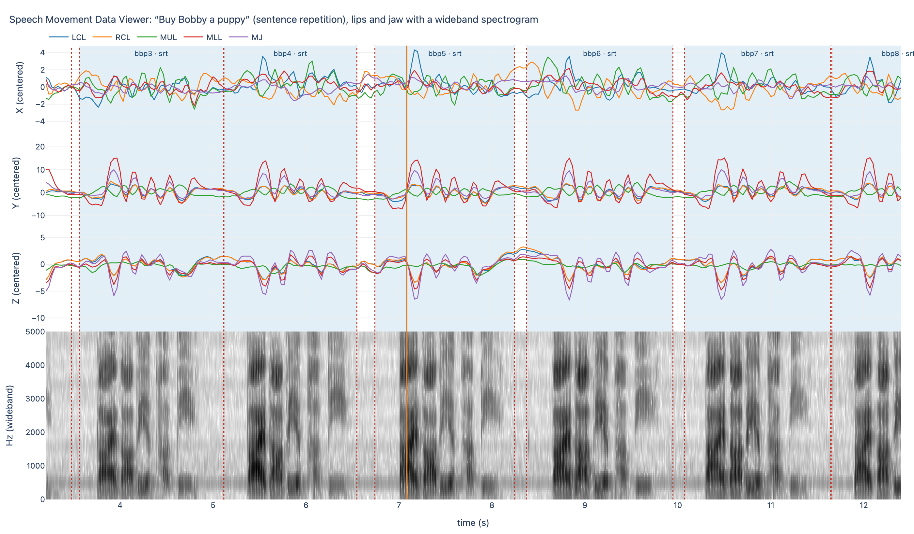

# WCKDSMAT

**Measure 3D lip, jaw and head movement during speech from an ordinary webcam video.**

WCKDSMAT turns a video of someone talking into millimetre-scale movement trajectories for the lips, jaw and head, without markers, sensors or a motion-capture lab. It uses Google's [MediaPipe Face Mesh](https://github.com/google-ai-edge/mediapipe/wiki/MediaPipe-Face-Mesh) to track the face, calibrates the result to real units, removes head motion, and computes displacement, velocity and acceleration for the speech segments you mark. A built-in viewer shows the movement alongside a spectrogram of the audio, so you can annotate and segment recordings by ear and by eye.

It was built for speech-motor research (diadochokinesis, sentence repetition, maximal-movement and oral-motor tasks) with populations who can't easily come to a lab or tolerate sensors, such as young children, minimally verbal autistic people, and people with advanced disease.

> **Validated against optical motion capture.** Against simultaneous 120 Hz motion capture, mean 3D position error was **2.03 ± 0.59 mm** (unbiased RMSE, 116 speech segments, 4 adults), with no loss of accuracy at 15 fps ([Sanchez et al., Interspeech 2026](#citation)). The `interspeech2026` preset reproduces that analysis.

## What you get

| | |
|---|---|
| **Landmark tracking** | 468 Face Mesh points (478 with iris) per frame, from any video |
| **Calibration** | pixels → millimetres from the participant's eye-corner distance, or face-relative units |
| **Head-motion removal** | rigid head normalization, so lip and jaw movement is measured relative to the head |
| **Head movement** | the head's own trajectory is kept separately, for head-movement analyses |
| **Kinematics** | per-segment position, displacement (from segment onset), velocity and acceleration, in X, Y, Z and 3D |
| **Speech Movement Data Viewer** | movement and a wide- or narrowband spectrogram on one timeline, with playback, event flags and labeled segments |
| **Validation tools** | agreement with motion capture: uRMSE, normalized error, cross-correlation, lag, spectral centroid |
| **One config file** | which landmarks to track and every processing setting, with presets for speech work |

## Install

Requires Python 3.11 or newer. The viewer also needs [ffmpeg](https://ffmpeg.org/) to read audio from video.

```bash
pip install "wckdsmat[all] @ git+https://github.com/cheddarchunk/WCKDSMAT"
```

`[all]` adds video tracking (MediaPipe) and the viewer. Calibration, preprocessing, kinematics and validation need only the core install: `pip install "wckdsmat @ git+https://github.com/cheddarchunk/WCKDSMAT"`.

## Quick start

From a folder of videos to per-segment lip and jaw kinematics:

```bash
wckdsmat extract videos/ --out-dir work/                              # 1. track the face
wckdsmat calibrate work/*_gfm_sp_t.csv --eye-table eyes.csv --out-dir work/   # 2. pixels -> mm
wckdsmat preprocess work/*_cal.csv --out-dir work/                     # 3. remove head motion, filter
wckdsmat view work/SUBJ001_ddk_gfm_sp_t_cal_lp_hn.csv --video videos/SUBJ001_ddk.mov \
              --segments-table segments.csv                            # 4. mark the speech segments
wckdsmat kinematics work/*_lp_hn.csv --segments segments.csv --out-dir results/   # 5. kinematics
```

`eyes.csv` holds each participant's outer eye-corner distance (`recording,eye_distance_mm`). Without it you get face-relative units. Each step writes a `.meta.json` next to its output, recording exactly what it did.

**New to WCKDSMAT? Follow the step-by-step guide: [HOWTOUSE.md](HOWTOUSE.md).**

## How it works

```
video ──extract──▶ landmarks (px) ──calibrate──▶ mm ──preprocess──▶ head-normalized, filtered
                                                                        │
                                       view & annotate ──▶ segment table │
                                                                        ▼
                                                     kinematics per segment ──▶ (validate vs. motion capture)
```

The order follows the published method: calibrate, then head-normalize, then low-pass the full-length trajectory, then segment, then compute displacement from segment onset and its derivatives. Every setting lives in one TOML file; see [Configuration](HOWTOUSE.md#9-configuration-and-your-own-landmarks).

## Speech Movement Data Viewer



```bash
wckdsmat view RECORDING_lp_hn.csv --video RECORDING.mov
```

Pick the landmarks, play the audio with a playhead across every panel, switch between wideband (formants, bursts) and narrowband (harmonics) spectrograms, drop event flags with **F**, and label the intervals between flags. *Save segment table* writes the file the rest of the pipeline reads, and *Segment this file now* computes the kinematics on the spot. Details: [HOWTOUSE.md §5](HOWTOUSE.md#5-view-annotate-and-segment).

## Documentation

- [HOWTOUSE.md](HOWTOUSE.md): step-by-step guide, outputs, configuration and troubleshooting
- [docs/fix_log.md](docs/fix_log.md): signal conventions (3D traces are excursion, error or speed magnitudes, never ‖position‖)
- [docs/PROVENANCE.md](docs/PROVENANCE.md): how each stage was consolidated from the research code and checked against it

## Citation

If you use WCKDSMAT, please cite:

> Sanchez, V. E., Roesler, O., Neumann, M., Pautler, D., Richburg, B., Chenausky, K. V., Yunusova, Y., Ramanarayanan, V., & Green, J. (2026). From Lab to Laptop: Validating 3D Speech Kinematics with MediaPipe Face Mesh. *Proceedings of Interspeech 2026*.

GitHub's **Cite this repository** button (from [CITATION.cff](CITATION.cff)) gives this in BibTeX and APA.

## License

WCKDSMAT is free software under the [GNU Affero General Public License v3.0 or later](LICENSE) (`AGPL-3.0-or-later`). You may use, study, modify and share it. If you distribute a modified version, **or run one as a network service** (for example a hosted analysis platform or the viewer), you must make its source available under the same license, so improvements stay open.

*Version 1.0.0. Releases follow [semantic versioning](https://semver.org): 1.x releases keep the commands, config keys and file formats compatible. See [CHANGELOG.md](CHANGELOG.md).*
